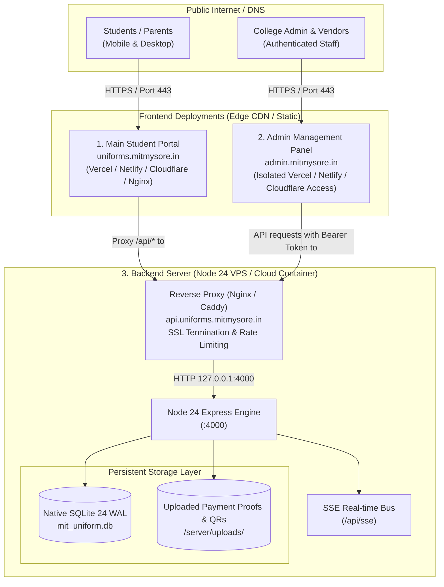

# MIT Mysore Uniform Management System — Multi-Target Deployment Guide

This guide details how to decouple and deploy the system into **three independent services**:
1. **Main MIT Uniform Website (Student Portal)** &rarr; `https://uniforms.mitmysore.in`
2. **Admin & Vendor Panel** &rarr; `https://admin.mitmysore.in`
3. **Backend API & Database Service** &rarr; `https://api.uniforms.mitmysore.in`

---

## 1. System Architecture & Topology



---

## 2. Backend Deployment (`https://api.uniforms.mitmysore.in`)

### Prerequisites & Storage Rules
> [!IMPORTANT]
> The backend relies on **Node.js 24 (`node:sqlite` DatabaseSync)** and local file persistence:
> - **Database file**: `server/data/mit_uniform.db` (Write-Ahead Logging enabled).
> - **Upload storage**: `server/uploads/payments/screenshots` and `server/uploads/payments/qrs`.
> 
> **Do NOT deploy the backend to ephemeral serverless runtimes** (such as standard AWS Lambda or Vercel serverless functions) because SQLite requires a writable, persistent disk. Use a VPS (Ubuntu EC2, DigitalOcean, Hetzner, Hostinger) or container platforms with **Persistent Disks/Volumes** (Render, Railway, Fly.io).

---

### Option A: Ubuntu Linux VPS (Recommended for Performance & Low Cost)

#### 1. Server Setup & Node.js 24 Installation
```bash
# Update server packages
sudo apt update && sudo apt upgrade -y
sudo apt install -y curl git build-essential nginx certbot python3-certbot-nginx

# Install Node.js 24.x LTS
curl -fsSL https://deb.nodesource.com/setup_24.x | sudo -E bash -
sudo apt install -y nodejs

# Verify Node 24 runtime
node -v   # Should output v24.x.x
npm -v

# Install PM2 Process Manager globally
sudo npm install -g pm2
```

#### 2. Clone & Configure Application
```bash
# Clone repository to /var/www
sudo mkdir -p /var/www
cd /var/www
git clone <YOUR_GIT_REPO_URL> mit-uniform-management
cd mit-uniform-management/server

# Install server dependencies
npm install --omit=dev

# Ensure data and upload directories exist with correct permissions
mkdir -p data uploads/payments/qrs uploads/payments/screenshots
```

#### 3. Production Environment File (`server/.env`)
Create `/var/www/mit-uniform-management/server/.env`:
```env
PORT=4000
NODE_ENV=production
JWT_SECRET=super_secure_random_64_character_hex_key_generate_one
ADMIN_INITIAL_PASSWORD=ChangeMeOnFirstLogin2026!
CORS_ORIGINS=https://uniforms.mitmysore.in,https://admin.mitmysore.in
```

#### 4. Configure PM2 for Zero-Downtime Daemonization
Create `/var/www/mit-uniform-management/server/ecosystem.config.cjs`:
```javascript
module.exports = {
  apps: [
    {
      name: 'mit-uniform-backend',
      script: 'index.js',
      cwd: '/var/www/mit-uniform-management/server',
      instances: 1, // Single instance required for SQLite write safety
      autorestart: true,
      watch: false,
      max_memory_restart: '1G',
      env: {
        NODE_ENV: 'production',
        PORT: 4000
      }
    }
  ]
};
```

Start the application:
```bash
pm2 start ecosystem.config.cjs
pm2 save
pm2 startup
```

#### 5. Configure Nginx Reverse Proxy & SSL
Create `/etc/nginx/sites-available/api.uniforms.mitmysore.in`:
```nginx
server {
    listen 80;
    server_name api.uniforms.mitmysore.in;

    client_max_body_size 25M;

    location / {
        proxy_pass http://127.0.0.1:4000;
        proxy_http_version 1.1;
        proxy_set_header Upgrade $http_upgrade;
        proxy_set_header Connection 'upgrade';
        proxy_set_header Host $host;
        proxy_set_header X-Real-IP $remote_addr;
        proxy_set_header X-Forwarded-For $proxy_add_x_forwarded_for;
        proxy_set_header X-Forwarded-Proto $scheme;
        proxy_cache_bypass $http_upgrade;
    }

    # Special handling for Server-Sent Events (SSE realtime sync)
    location /api/sse {
        proxy_pass http://127.0.0.1:4000/api/sse;
        proxy_http_version 1.1;
        proxy_set_header Connection '';
        proxy_set_header Host $host;
        proxy_buffering off;
        proxy_cache off;
        chunked_transfer_encoding on;
        proxy_read_timeout 24h;
    }
}
```

Enable site and acquire free Let's Encrypt SSL:
```bash
sudo ln -s /etc/nginx/sites-available/api.uniforms.mitmysore.in /etc/nginx/sites-enabled/
sudo nginx -t
sudo systemctl reload nginx
sudo certbot --nginx -d api.uniforms.mitmysore.in
```

---

### Option B: Docker Container Deployment

If you prefer Docker, create `server/Dockerfile`:
```dockerfile
FROM node:24-alpine
WORKDIR /app

# Install build dependencies for native binaries if needed
RUN apk add --no-cache python3 make g++

COPY package*.json ./
RUN npm ci --omit=dev

COPY . .

# Persistent directories
VOLUME ["/app/data", "/app/uploads"]

EXPOSE 4000
ENV NODE_ENV=production
CMD ["node", "index.js"]
```

And `docker-compose.yml`:
```yaml
version: '3.8'
services:
  backend:
    build: ./server
    container_name: mit-backend
    restart: always
    ports:
      - "4000:4000"
    environment:
      - PORT=4000
      - NODE_ENV=production
      - JWT_SECRET=secure_jwt_secret_value_2026
    volumes:
      - ./server-data:/app/data
      - ./server-uploads:/app/uploads
```

---

## 3. Main MIT Website Deployment (`https://uniforms.mitmysore.in`)

The main website hosts the **Student Uniform Registration & Tracking Portal** (`index.html`, `schedules.html`).

### Deployment via Vercel / Netlify / Cloudflare Pages

1. **Root Directory**: `client`
2. **Build Command**: `npm run build`
3. **Output Directory**: `dist`
4. **Environment Variables**:
   ```env
   VITE_API_URL=https://api.uniforms.mitmysore.in
   ```

#### Zero-CORS Reverse Proxy (`client/vercel.json`)
By adding a rewrite configuration in `vercel.json`, student browsers call `/api/...` directly without running into cross-origin or pre-flight latency:
```json
{
  "rewrites": [
    {
      "source": "/api/:path*",
      "destination": "https://api.uniforms.mitmysore.in/api/:path*"
    },
    {
      "source": "/uploads/:path*",
      "destination": "https://api.uniforms.mitmysore.in/uploads/:path*"
    },
    {
      "source": "/schedules",
      "destination": "/schedules.html"
    },
    {
      "source": "/((?!api|uploads|admin).*)*",
      "destination": "/index.html"
    }
  ]
}
```

---

## 4. Admin Panel Deployment (`https://admin.mitmysore.in`)

Deploying the admin panel under its own subdomain allows strict security controls (e.g. Cloudflare Zero Trust, campus IP restriction, or VPN protection).

### Deployment Setup

1. **Root Directory**: `client`
2. **Build Command**: `npm run build`
3. **Output Directory**: `dist`
4. **Environment Variables**:
   ```env
   VITE_API_URL=https://api.uniforms.mitmysore.in
   ```

#### Route Root (`/`) Directly to Admin (`client/vercel.admin.json`)
Configure your admin Vercel / Netlify project so visiting `https://admin.mitmysore.in` serves `admin.html` at the root path:
```json
{
  "rewrites": [
    {
      "source": "/api/:path*",
      "destination": "https://api.uniforms.mitmysore.in/api/:path*"
    },
    {
      "source": "/uploads/:path*",
      "destination": "https://api.uniforms.mitmysore.in/uploads/:path*"
    },
    {
      "source": "/vendor/:path*",
      "destination": "/vendor-portal.html"
    },
    {
      "source": "/",
      "destination": "/admin.html"
    },
    {
      "source": "/((?!api|uploads).*)*",
      "destination": "/admin.html"
    }
  ]
}
```

> [!TIP] Security Best Practice for Admin Panel
> - Place `admin.mitmysore.in` behind **Cloudflare Zero Trust Access** (free for up to 50 users).
> - Enable email pin codes or Google Workspace / College SSO so unauthorized users cannot even access the login form.

---

## 5. Automated SQLite Backup Strategy

Because SQLite is file-based, backups are simple and atomic using Node or standard `sqlite3` CLI:

Add a daily cron job on the VPS (`crontab -e`):
```bash
# Atomic daily backup of SQLite database at 02:00 AM
0 2 * * * node -e "const { DatabaseSync } = require('node:sqlite'); const db = new DatabaseSync('/var/www/mit-uniform-management/server/data/mit_uniform.db'); db.exec('PRAGMA wal_checkpoint(TRUNCATE);');" && cp /var/www/mit-uniform-management/server/data/mit_uniform.db /var/backups/mit_uniform_$(date +\%F).db
```

---

## 6. Summary Checklist for Go-Live

| Component | Target URL | Hosting Platform | Key Configuration |
|---|---|---|---|
| **Backend API** | `api.uniforms.mitmysore.in` | Ubuntu VPS / Docker / Render with Volume | Node 24, PM2, persistent volume for `/data` and `/uploads`, SSL via Certbot |
| **Main Website** | `uniforms.mitmysore.in` | Vercel / Netlify / Cloudflare Pages | `VITE_API_URL`, rewrites `/api/*` to backend |
| **Admin Panel** | `admin.mitmysore.in` | Vercel / Cloudflare Pages / VPS | Rewrite `/` to `admin.html`, optional Cloudflare Zero Trust |
