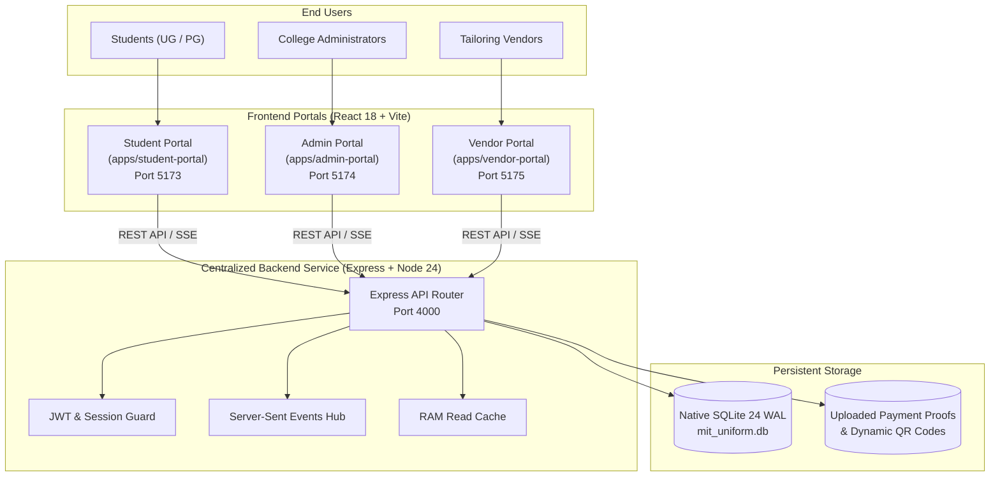

# MIT Uniform Management System — Architecture Specification

## 1. System Overview

The MIT Uniform Management System is an enterprise-grade academic uniform procurement, sizing, reconciliation, and distribution management system developed specifically for Maharaja Institute of Technology Mysore (MITM).



## 2. Directory Structure

```
MIT-UNIFORM-MANAGEMENT-SYSTEM/
│
├── apps/
│   ├── student-portal/     # Registration, sizing, payment proof, slip download
│   ├── admin-portal/       # Super-admin dashboard, allocations, payment reconciliation
│   └── vendor-portal/      # Vendor tailor measurements, student lists, collection marks
│
├── server/
│   ├── src/
│   │   ├── config/         # Database and application status initialization
│   │   ├── routes/         # Modular REST endpoints (11 modules)
│   │   ├── middleware/     # USN validation, RAM caching, role guards
│   │   ├── services/       # SSE hub, in-memory cache
│   │   └── utils/          # Garment configurations, USN regex helpers
│   ├── data/               # Persistent SQLite database (mit_uniform.db)
│   ├── uploads/            # Payment screenshots and QR codes
│   └── index.js            # Server entrypoint
│
├── database/
│   ├── schema/             # DDL schema definitions (89 items)
│   ├── migrations/         # Versioned SQL migrations
│   ├── seeds/              # Initial administration seeds
│   └── backups/            # Database backups and backup scripts
│
├── shared/
│   ├── types/              # Unified TypeScript definitions
│   ├── constants/          # Academic departments, fit types, sizes
│   └── validation/         # VTU USN, phone, UTR validation rules
│
├── infrastructure/
│   ├── deployment/         # Nginx configs, Vercel configs, PM2 ecosystem
│   ├── docker/             # Dockerfile and docker-compose
│   └── scripts/            # Health check and maintenance scripts
│
└── documentation/          # Handover and architecture specifications
```

## 3. Technology Stack

- **Runtime**: Node.js 24 LTS (utilizing native `node:sqlite` `DatabaseSync`)
- **Backend Framework**: Express 4.21.2 with Helmet and CORS
- **Frontend Framework**: React 18.3.1 with TypeScript and Vite 6
- **Styling**: Tailwind CSS 4.3.3
- **Icons**: Lucide React
- **Document Generation**: jsPDF + html2canvas
